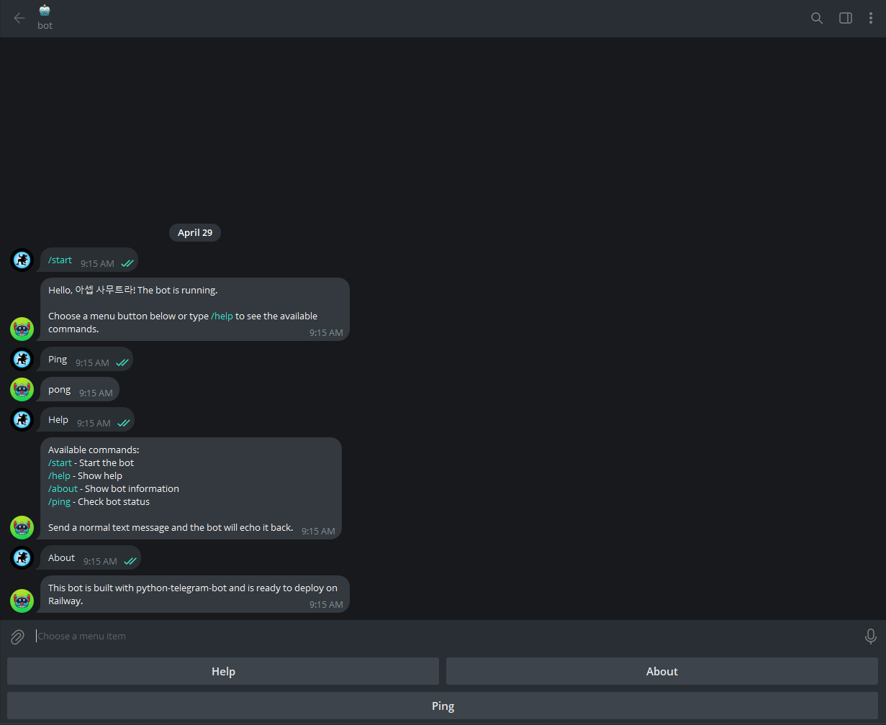

# Telegram Bot with python-telegram-bot

[](https://railway.com/deploy/python-telegram-bot?referralCode=asepsp&utm_medium=integration&utm_source=template&utm_campaign=generic)

A starter Telegram bot project built with [`python-telegram-bot`](https://python-telegram-bot.org/), environment-based configuration, Docker support, and Railway deployment setup.



## Features

- Persistent chat menu buttons after `/start`
- `/start`, `/help`, `/about`, and `/ping` commands
- Anonymous submissions for text, photos, videos, and files with manual approval
- Periodic standardized message in the publish channel with moderator-adjustable interval (default: 8 hours)
- Fallback handler for unknown commands
- Error logging
- **PostgreSQL persistence** (asyncpg): users and anonymous submissions are stored
- **Redis integration**: short-lived `/ping` cache
- Configuration loaded from a local `.env` file or Railway variables
- Ready to run with Docker and Railway

## Data Stores

PostgreSQL and Redis are **optional** for the starter features. When `DATABASE_URL` /
`REDIS_URL` are set the bot connects on startup; when they are missing, empty, or unreachable
it logs a warning and keeps running with that backend disabled.

- **PostgreSQL** — `users` and `anonymous_submissions` tables are created automatically on
  first run. `/start` inserts a new user or refreshes `username`, `first_name`, and `last_seen`
  for an existing one. Anonymous submissions need this database to store moderation state.
  Without a database, `/start` still greets the user but the review flow is disabled.
- **Redis** — `/ping` reports whether the reply came from a 10-second cache (`fresh` vs
  `cached`). Without Redis, `/ping` replies with a plain `pong`.

Connections are pooled (asyncpg) and reused across updates, then closed cleanly on shutdown.

## Chat Menu Buttons

The bot shows a persistent reply keyboard after `/start` with these buttons:

| Button  | Action                           |
| ------- | -------------------------------- |
| `Help`  | Show available commands          |
| `About` | Show short bot information       |
| `Ping`  | Check whether the bot is running |

Telegram bots cannot display custom buttons before a user starts or messages the bot. The keyboard appears after the bot replies, then stays available in supported Telegram clients.

## Anonymous Moderation Flow

1. A user sends text, a photo, a video, a file, or a media group to the bot.
2. The bot sends an anonymous preview to the review chat with Approve / Reject buttons.
3. On approval, the bot copies the original content into the private channel.
4. On rejection, the bot marks the submission as rejected and notifies the sender.

Required environment variables for this flow:

- `REVIEW_CHAT_ID` — chat where the reviewer receives pending submissions
- `PUBLISH_CHANNEL_ID` — private channel that receives approved posts

The bot must be allowed to post in the target channel and to send messages in the review chat.

## Bot Commands

| Command  | Description                      |
| -------- | -------------------------------- |
| `/start` | Show the welcome message         |
| `/help`  | Show available commands          |
| `/about` | Show short bot information       |
| `/ping`  | Check whether the bot is running |
| `/broadcast_set <message>` | Set periodic standardized message (moderator only) |
| `/broadcast_interval <hours>` | Adjust the interval between periodic broadcasts (moderator only) |
| `/broadcast_send_now` | Send the configured standardized message immediately (moderator only) |
| `/broadcast_on` | Enable periodic publishing (moderator only) |
| `/broadcast_off` | Disable periodic publishing (moderator only) |
| `/broadcast_status` | Show periodic publishing status (moderator only) |
| `/cleanup_set <hours>` | Set the maximum message age before channel cleanup removes it (moderator only) |
| `/cleanup_on` | Enable automatic channel cleanup (moderator only) |
| `/cleanup_off` | Disable automatic channel cleanup (moderator only) |
| `/cleanup_status` | Show the cleanup status (moderator only) |
| `/autoaccept_set <hours>` | Set the interval for automatic approval of pending messages (moderator only) |
| `/autoaccept_on` | Enable automatic approval outside the nightly window (moderator only) |
| `/autoaccept_off` | Disable automatic approval (moderator only) |
| `/autoaccept_status` | Show the automatic approval status (moderator only) |

### Periodic Standardized Message

- The periodic message is sent to `PUBLISH_CHANNEL_ID` when enabled, using a moderator-configurable interval that defaults to 8 hours.
- Only users listed in `MODERATOR_IDS` can configure or control this flow.
- Typical setup:
  1. Configure `MODERATOR_IDS` with comma-separated Telegram user IDs.
  2. Define the message with `/broadcast_set <message>`.
  3. Adjust the cadence with `/broadcast_interval <hours>` if needed.
  4. Use `/broadcast_send_now` to publish it immediately when needed.
  5. Activate with `/broadcast_on`.
  6. Check status with `/broadcast_status`.

### Channel Cleanup

- The bot can automatically delete stale messages from `PUBLISH_CHANNEL_ID` when cleanup is enabled.
- The maximum age is configured with `/cleanup_set <hours>` and defaults to 72 hours (3 days).
- The cleanup task runs every 5 hours instead of scanning the channel every minute, which keeps it lightweight while still removing stale messages.
- The first message in the chat is always ignored, and any additional protected message IDs can be listed in `CLEANUP_IGNORED_MESSAGE_IDS` as a comma-separated list, such as `6` to keep `https://t.me/c/4408862765/6`.
- Typical setup:
  1. Set `CLEANUP_IGNORED_MESSAGE_IDS` in the environment with any message IDs to preserve.
  2. Configure the age with `/cleanup_set <hours>`.
  3. Activate with `/cleanup_on`.
  4. Check status with `/cleanup_status`.

### Automatic Approval

- Moderators can enable an automatic approval routine that publishes pending anonymous submissions without waiting for a manual click.
- The approval cycle runs every configured number of hours and skips the nightly window from 22:00 to 08:00.
- Buttons for Approve / Reject remain available, so the manual veto still works the majority of the time when the auto-approval routine is disabled.
- Typical setup:
  1. Configure the interval with `/autoaccept_set <hours>`.
  2. Enable it with `/autoaccept_on`.
  3. Check the automation with `/autoaccept_status`.


## Project Structure

```text
.
├── bot/
│   ├── __init__.py
│   ├── cache.py        # Redis client and helpers
│   ├── config.py
│   ├── db.py           # PostgreSQL pool and queries
│   ├── handlers.py
│   └── main.py
├── .env
├── .env.example
├── .dockerignore
├── .gitignore
├── Dockerfile
├── LICENSE
├── railway.json
├── README.md
└── requirements.txt
```

## Set Up the Bot Token

1. Create a bot with Telegram `@BotFather`.
2. Copy the bot token.
3. Add the token to `.env`:

## Environment Variables

| Name           | Required | Default | Description                                        |
| -------------- | -------- | ------- | -------------------------------------------------- |
| `BOT_TOKEN`    | Yes      | -       | Bot token from `@BotFather`                        |
| `DATABASE_URL` | No       | -       | PostgreSQL connection string; omit to run without persistence |
| `REDIS_URL`    | No       | -       | Redis connection string; omit to run without caching          |
| `REVIEW_CHAT_ID` | No     | -       | Chat ID for manual review of anonymous submissions |
| `PUBLISH_CHANNEL_ID` | No  | -       | Private channel ID that receives approved content  |
| `MODERATOR_IDS` | No      | -       | Comma-separated Telegram user IDs allowed to manage periodic broadcasts and cleanup routines |
| `CLEANUP_IGNORED_MESSAGE_IDS` | No | - | Comma-separated channel message IDs that should never be deleted by the cleanup task |
| `LOG_LEVEL`    | No       | `INFO`  | Logging level, such as `DEBUG`, `INFO`, or `ERROR` |

On Railway, add the **PostgreSQL** and **Redis** plugins to your project and reference their
connection strings from the bot service:

```text
DATABASE_URL=${{ Postgres.DATABASE_URL }}
REDIS_URL=${{ Redis.REDIS_URL }}
```

For local development you can run both with Docker:

```bash
docker run -d --name pg  -e POSTGRES_PASSWORD=postgres -p 5432:5432 postgres:16
docker run -d --name red -p 6379:6379 redis:7
```

## Install and Run Locally

Make sure Python 3.10 or newer is installed.

```bash
python -m venv .venv
source .venv/bin/activate
pip install -r requirements.txt
python -m bot.main
```

For Windows PowerShell:

```powershell
python -m venv .venv
.\.venv\Scripts\Activate.ps1
pip install -r requirements.txt
python -m bot.main
```

## Run with Docker

```bash
docker build -t telegram-bot .
docker run --env-file .env telegram-bot
```

## License

This project is licensed under the MIT License. See [LICENSE](LICENSE).
